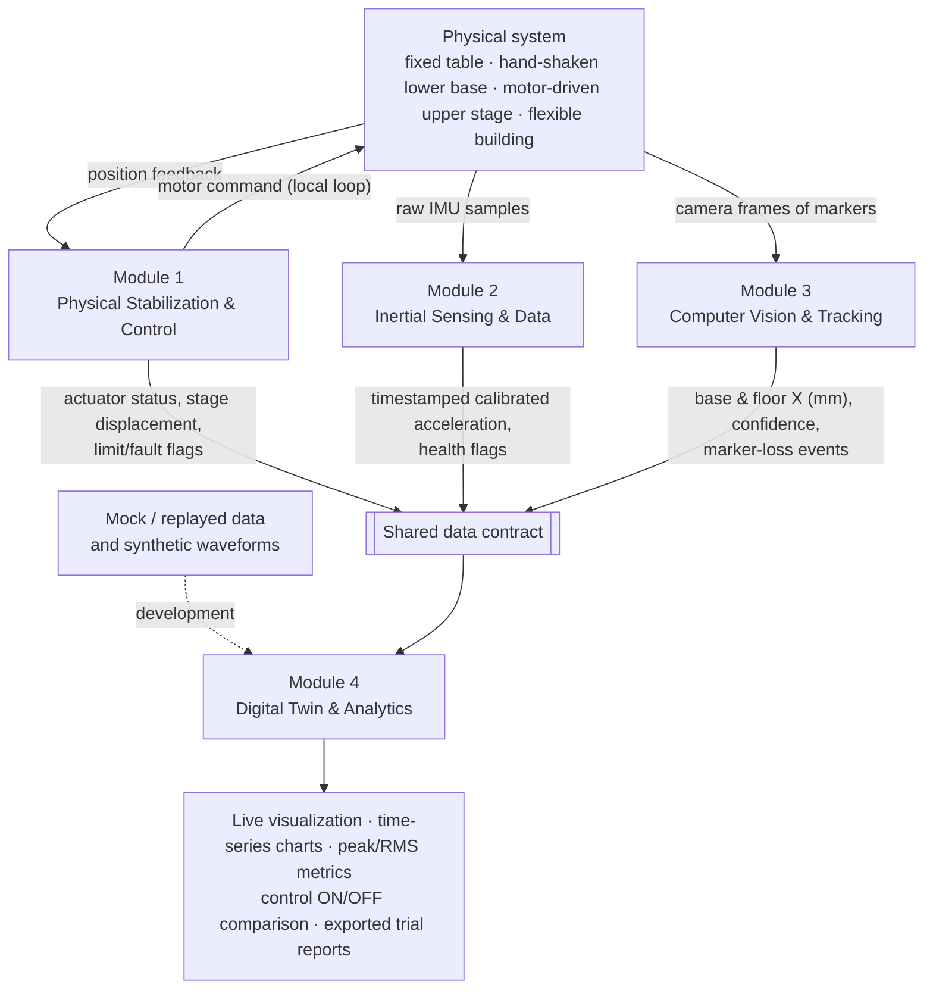

# STRATA

**Active Base Stabilization and Real-Time Structural Digital Twin**

*We build safety, not assumptions.*

CENG 396 · Group 5 · Instructor: Erkan Zergeroğlu

---

## Overview

Strata is a small-scale, one-axis active base-isolation demonstrator.

A three-story flexible building model stands on a motor-driven upper linear stage. That stage rests on a separate lower platform, which is shaken by hand along a single horizontal axis. A local feedback controller moves the upper stage relative to the shaken base to reduce the motion transmitted to the building.

Rather than assuming that a level-looking platform is stable, the system **measures** both the disturbance applied at the base and the actual motion of the building:

- a fixed external camera tracks visual markers,
- inertial measurement units (IMUs) measure acceleration,
- encoders or linear sensors provide stage-position feedback.

A live digital-twin dashboard synchronizes these measurements and compares the same structure with control switched **OFF** and **ON**.

> **Measure, don't assume.**

## How it works

1. The lower base is disturbed manually along a single horizontal (X) axis.
2. Position feedback measures the lower base relative to the fixed table, and the upper stage relative to the lower base.
3. The local controller drives the motor so that the upper stage produces a controlled counter-motion against the measured base motion.
4. The camera and IMUs record the base input and the building response, which the live dashboard displays as a synchronized digital twin.

### System layers

| # | Layer |
|---|---|
| 01 | Fixed reference table |
| 02 | Hand-shaken lower base |
| 03 | Motor-driven upper stage |
| 04 | Flexible building with visual markers and IMUs |

## Architecture



Modules 1–3 sense or act on the physical system independently. Module 1 closes the motor loop locally, so it never waits for the camera or the dashboard. Every stream reaches Module 4 through the shared data contract, and Module 4 can be developed in parallel with mock or replayed data.

## Modules

| Module | Members | Focus | Independent deliverable |
|---|---|---|---|
| **1 · Physical Stabilization & Control** | at least 4 | Rails, manual base, upper stage, motor, local position feedback, safe PID | Bench-tested and safely moving active stage |
| **2 · Inertial Sensing & Data** | at least 2 | IMU mounting, sampling, calibration, timestamps, filtering | Reliable timestamped IMU data stream |
| **3 · Computer Vision & Tracking** | at least 2 | Fixed camera, visual markers, calibration, displacement tracking | Live marker displacement in millimeters |
| **4 · Digital Twin & Analytics** | at least 2 | Structure visualization, live graphs, comparison metrics, trial logging | Dashboard tested with mock or real streams |

<details>
<summary><b>Module 1 — Physical Stabilization & Control</b></summary>

Builds both linear motion layers and the flexible building model, selects the actuator, and implements a local closed-loop controller with safe stroke limits, position feedback and an emergency stop.

- **Input:** measured lower-base position relative to the fixed table; measured upper-stage position relative to the lower base; mode and safety commands.
- **Output:** motor command, stage displacement, limit/fault flags and time-stamped control status.
- **Independent test:** bench-test the upper stage with scripted position requests, then shake the lower base while measuring upper-stage absolute motion. Test physical stops and loss-of-signal behavior before attaching the building.
</details>

<details>
<summary><b>Module 2 — Inertial Sensing & Data Acquisition</b></summary>

Provides calibrated motion measurements from the base and the structure, independently of the camera and the visualization software.

- **Input:** raw IMU acceleration / angular-rate samples, device settings and a time reference.
- **Output:** timestamped calibrated acceleration, sensor health flags, and recorded, replayable sample streams.
- **Independent test:** mount an IMU on a hand-shaken test board; verify static gravity, sensor orientation, noise and repeatability. Replay logs to test filtering and missing-sample handling.
</details>

<details>
<summary><b>Module 3 — Computer Vision & Motion Tracking</b></summary>

Uses an externally fixed camera and visual markers to measure the horizontal displacement of the lower base and of each building floor.

- **Input:** camera frames, reference markers, calibration scale and timestamp information.
- **Output:** base and floor X displacements in mm with timestamps, tracking confidence and marker-loss events.
- **Independent test:** move a marked board through known distances (for example 10 and 20 mm), compare the tracked displacement against a ruler, and test blur and occlusion cases with recorded videos.
</details>

<details>
<summary><b>Module 4 — Digital Twin & Analytics</b></summary>

Displays a live structural model with synchronized data plots, and compares measured motion with any simplified model predictions without conflating the two.

- **Input:** timestamped actuator status, IMU signals and marker positions; mock or replayed data during development.
- **Output:** live structural visualization, time-series charts, peak/RMS metrics, control ON/OFF comparison and exported trial reports.
- **Independent test:** stream known synthetic waveforms and mock JSON logs into the dashboard. Validate plotted values, model response, file export and graceful handling of missing data.
</details>

## Shared data contract

Every stream exchanged between modules follows the same conventions. The full field list lives in [`shared/`](shared/).

| Convention | Agreement |
|---|---|
| Direction | Signed X (single horizontal axis) |
| Units | Millimeters (displacement), m/s² (acceleration) |
| Metadata | Sensor source and timestamps |
| Quality | Confidence / health flags |
| Control state | Actuator limits and ON/OFF state |
| Development | Non-critical modules can start with generated data or replayed logs |

## Final demonstration

The final demonstration compares two states of the same structure under measured, comparable manual disturbances.

| Configuration | What happens | What we measure |
|---|---|---|
| **A — Control OFF** | Upper stage held at a defined reference position relative to the lower base | Base input, roof displacement and acceleration |
| **B — Control ON** | Local feedback controller drives the upper stage to oppose the measured base motion | The same responses, plus actuator travel and control signal |

**Success measure:** compare top-floor peak and RMS displacement and acceleration between the two configurations, while recording the input disturbance, actuator travel and controller limits.

**Expectations:** demonstration outcomes are targets to be tested, not guaranteed reduction figures.

**Scope:** a low-amplitude, one-direction educational demonstrator. It is not a real-earthquake simulator, a building safety certification, or a system claiming protection from all disturbances.

## Repository structure

```
strata/
├── docs/            Module documentation, diagrams, test records, user manual
├── shared/          Shared data contract (single source of truth)
├── m1-control/      Module 1 · firmware, calibration, safety tests
├── m2-imu/          Module 2 · IMU acquisition, calibration, filtering
├── m3-vision/       Module 3 · marker tracking, camera calibration
├── m4-dashboard/    Module 4 · digital twin dashboard, analytics
└── simulation/      Live simulation of the setup
```

Changes to `shared/` go through a pull request reviewed by every module.

## Milestones

| Date | Milestone | Status |
|---|---|---|
| 16 Oct 2026 | Project proposal | ✅ Done |
| 6 Nov 2026 | Module documentation (input/output block diagrams) | 🔄 In progress |
| 4 Dec 2026 | Module demos — each module works on its own | ⏳ |
| 30 Dec 2026 | Final product, full-system demo and user manual | ⏳ |

## Team

| Name | Module | GitHub |
|---|---|---|
| Hatice Günışık | | |
| Zeynep Çelik | | |
| Gülbin Coşkun | | |
| Safa Nadeem | | |
| Semih Çakır | | |
| Enes Taha Kılıç | | |
| Ege Özer | | |
| Emre Akpınar | | |
| Ahmet Yaşar Göksü | | |
| Ahmet Çolak | | |

**Instructor:** Erkan Zergeroğlu

---

<p align="center"><sub>STRATA · CENG 396 · We build safety, not assumptions.</sub></p>
