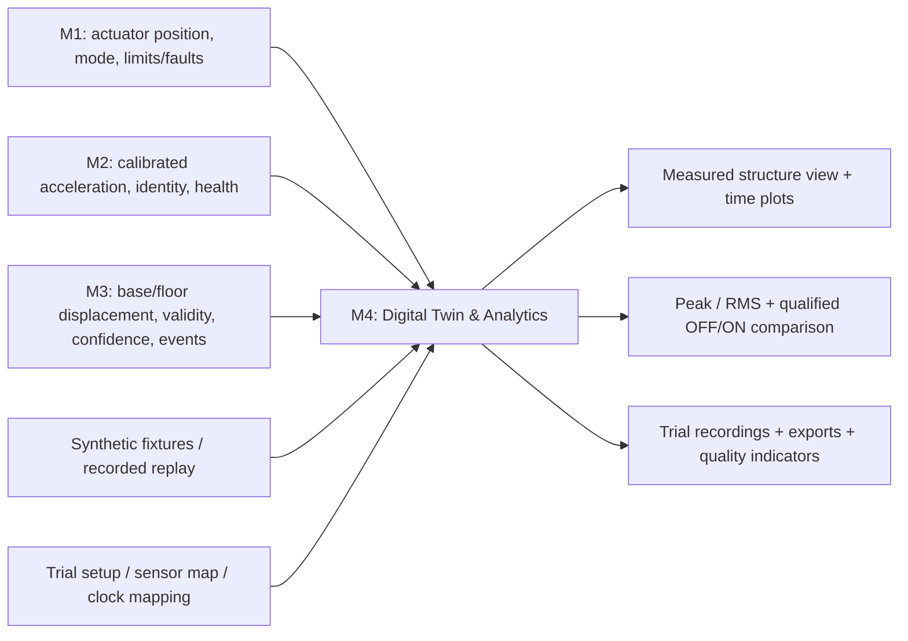
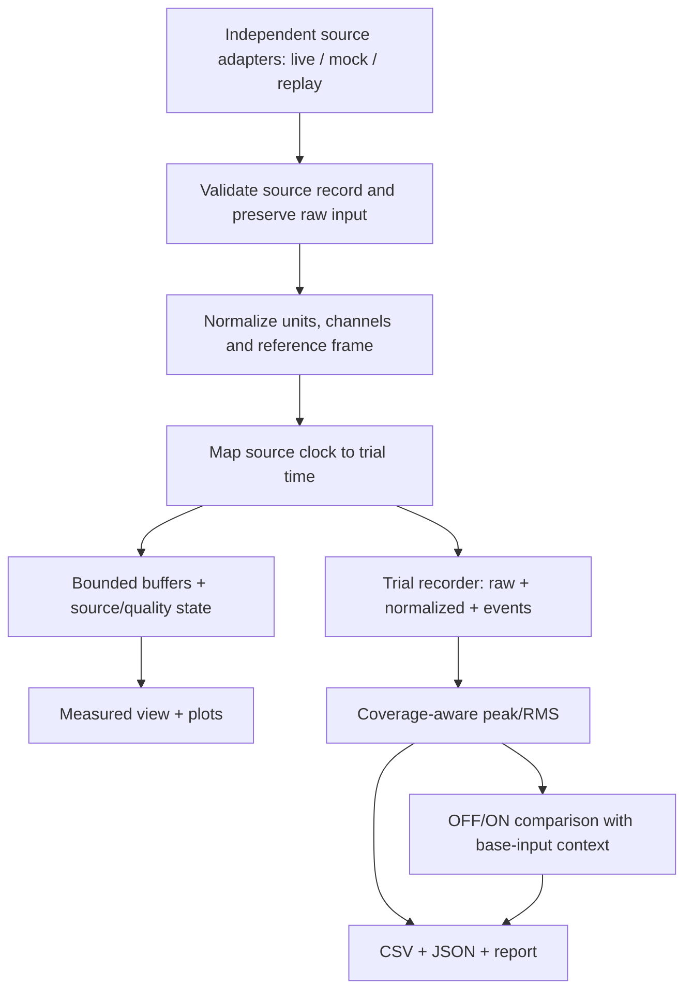
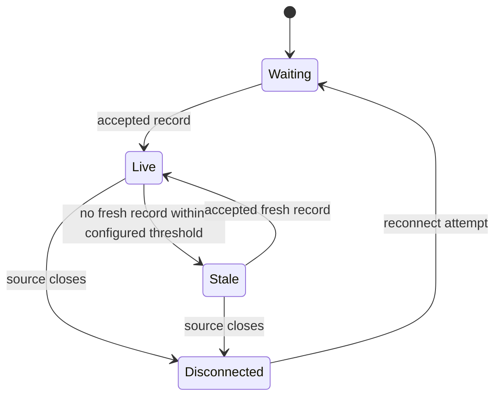

# Module 4 architecture proposal

Status: design only, 5 November 2026. No transport or UI framework is finalized.

## Module input/output boundary



M4 is downstream. No edge sends camera or dashboard data into M1's motor loop.

## Internal flow



Unsynchronized sources can be displayed on clearly labelled local timelines, but
cannot enter synchronized cross-source analysis. Slow rendering must not block
source acquisition. Recording failure is visible and marks the trial incomplete.

## Interface wireframe (proposed)

```text
+---------------------------------------------------------------------+
| STRATA | LIVE / MOCK / REPLAY | Trial ID | ON/OFF/UNKNOWN | Recording |
+------------------------------------+--------------------------------+
| Measured front view                | Displacement vs trial time (mm)|
| fixed reference + base             | BASE, FLOOR_1, FLOOR_2, FLOOR_3 |
| stage if available + 3 floors      +--------------------------------+
| visible quality/age per target     | Acceleration vs time (m/s²)    |
| scale and exaggeration label       | configured sensors only        |
+------------------------------------+--------------------------------+
| M1 status | M2 status | M3 status | clock mapping | loss/fault events |
+---------------------------------------------------------------------+
| Window | Peak | RMS | coverage | OFF/ON trials + base-input context  |
| Start/stop recording | Replay | Export | incomplete-data warnings    |
+---------------------------------------------------------------------+
```

Controls affect M4 recording/replay only. A control-state badge displays the
reported M1 mode; it is not a motor ON/OFF switch.

## Source and measurement state



Measurement validity is separate: a live CV connection may deliver invalid
measurements while a marker is occluded. On reconnect, revalidate source metadata
and trial/clock identity before accepting records into the previous segment.
